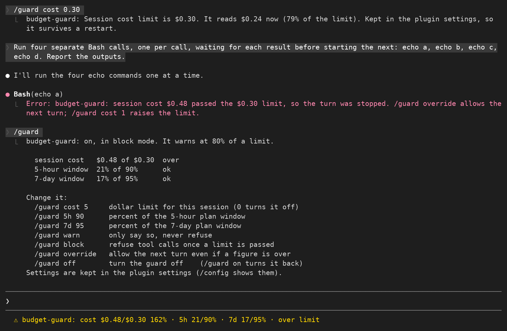

# budget-guard

A spending guard for Claude Code, built as a mod (function hooks).

It watches three figures against limits you set and stops work when one is passed:

- the session cost in dollars,
- how much of the 5-hour plan window is used,
- how much of the 7-day plan window is used.

While everything is under the warning mark it shows nothing at all.

## What it does

At 80% of a limit it shows a toast once and pins a line under the prompt:

```
budget-guard: cost $4.10/$5.00 82% · 5h 71/90% · 7d 15/95%
```

The line stays while any figure is at the warning level or over, and goes away as soon as everything is back under it.
The toast only repeats when the level changes.

Past a limit in `block` mode, which is the default, two things happen.

First, the next tool call is refused (a subagent's too, since subagents also spend) and the turn is stopped.
Stopping the turn matters because a model that is refused one tool tries another, and every attempt is a billed API call:

```
● Bash(echo c)
  ⎿  Error: budget-guard: session cost $0.67 passed the $0.66 limit, so the turn was stopped.
     /guard override allows the next turn; /guard cost 2 raises the limit.
```

Second, sending a new prompt asks you first:

```
 ☐ Budget
Session cost is $0.59, past its $0.36 limit. Send this prompt anyway?
❯ 1. Send anyway
  2. Do not send
```

"Send anyway" sets an override for that one turn.
"Do not send" drops the prompt and says why:

```
● Prompt dropped by a hook: budget-guard: session cost $0.59 passed the $0.36 limit.
  The prompt was not sent. /guard override sends the next one; /guard cost 1 raises the limit.
```

Past a limit in `warn` mode, nothing is refused.
The guard shows one toast per turn and keeps the status line pinned.

## Install

```
claude plugin marketplace add Arunjay4213/claude-mods
claude plugin install budget-guard@claude-mods
```

Mods are early access, so the module only loads when function hooks are switched on.
Add this to `~/.claude/settings.json`:

```json
{ "env": { "CLAUDE_CODE_ENABLE_FUNCTION_HOOKS": "1" } }
```

Or set it for one run: `CLAUDE_CODE_ENABLE_FUNCTION_HOOKS=1 claude`.

## Screenshot



## `/guard`

`/guard` with no arguments prints the current state:

```
budget-guard: on, in block mode. It warns at 80% of a limit.

  session cost   $0.31, no limit  not guarded
  5-hour window  14% of 90%       ok
  7-day window   15% of 95%       ok

Change it:
  /guard cost 5     dollar limit for this session (0 turns it off)
  /guard 5h 90      percent of the 5-hour plan window
  /guard 7d 95      percent of the 7-day plan window
  /guard warn       only say so, never refuse
  /guard block      refuse tool calls once a limit is passed
  /guard override   allow the next turn even if a figure is over
  /guard off        turn the guard off    (/guard on turns it back)
```

`/guard override` lasts exactly one turn.
A subagent's turn finishing inside your turn does not use it up.

## Settings

The six settings are the plugin's own `userConfig` fields, so `/config` shows them too.

| Field | Default | What it is |
| --- | --- | --- |
| `costLimitUsd` | `0` | Dollars this session may spend. 0 turns the cost guard off. |
| `fiveHourLimitPercent` | `90` | Percent of the 5-hour plan window allowed. |
| `sevenDayLimitPercent` | `95` | Percent of the 7-day plan window allowed. |
| `warnAtPercent` | `80` | How far along a limit counts as a warning. |
| `mode` | `block` | `block` refuses work past a limit, `warn` only says so. |
| `enabled` | `true` | Turn the whole guard off without uninstalling it. |

Changing one with `/guard` writes it through `$.config.set` into `~/.claude/settings.json` under `pluginConfigs["budget-guard"].options`, so it survives a restart.
Claude Code reloads the module whenever its options change, and that reload is the short "options changed - reloaded" notice you see after `/guard cost 5`.

If a host refuses to let a plugin write its own `userConfig` row, the guard keeps the same six fields in `$.store` instead, and `/guard` says "Kept in the plugin store" where it would otherwise say "Kept in the plugin settings".
The `$.config.set` path works on the Claude Code build this was written against (2.1.272), so the fallback should be rare.

## Where the numbers come from

Everything is read with `$.session.usage()` called with no argument.
That form is free, because it only reports the figures the last API response already carried.

- `cost.usd` is the same dollar figure `/cost` and the status line show.
- `rateLimits[]` carries `five_hour` and `seven_day` with a `percentUsed`, rounded here with `Math.round`.

It reads at `session.start`, after every turn, and inside `tool.call` just before deciding, since cost keeps moving during a turn.

The guard times the `tool.call` read once per session and writes the result to the debug log:

```
[budget-guard] $.ui.log: session.usage() took 5 ms in tool.call - under 30 ms, so every check reads live
```

If the read takes longer than 30 ms, the guard caches it for 3 seconds instead of reading on every tool call.
Both cases showed up in testing: 5 ms on a cold worker, and 62 ms on a reloaded one, where the cache turned itself on.

## Limitations

When a hook throws or times out, the engine skips it and runs the hooks beneath it and Claude Code's own logic instead.
So the guard can fail open.
It is meant to keep an expensive session from drifting past a budget you chose, and it cannot enforce a spending policy on someone who does not want one; anyone can run `/guard off`.

The refusal applies to the *next* tool call, after which the turn stops.
API calls that have already started still finish and are billed, so cost can end up a little past the limit before anything is refused.
In practice the overshoot is one model step.

API-key sessions get no window guards.
`rateLimits` is empty without a subscription, so the 5-hour and 7-day figures never arrive and those two guards stay inactive.
`/guard` says this, and the cost guard still works.

The engine's cost ledger updates as each API response is accounted for, between steps.
A short single-step turn can therefore end past the limit without any tool call being refused, and the next turn is caught at `prompt.submit`.

`$.ui.ask` needs a person at the keyboard.
In a `-p` or SDK run there is nobody to ask, so a prompt submitted while a figure is over is dropped with the reason.
To get past it, use `/guard override` or raise the limit.
