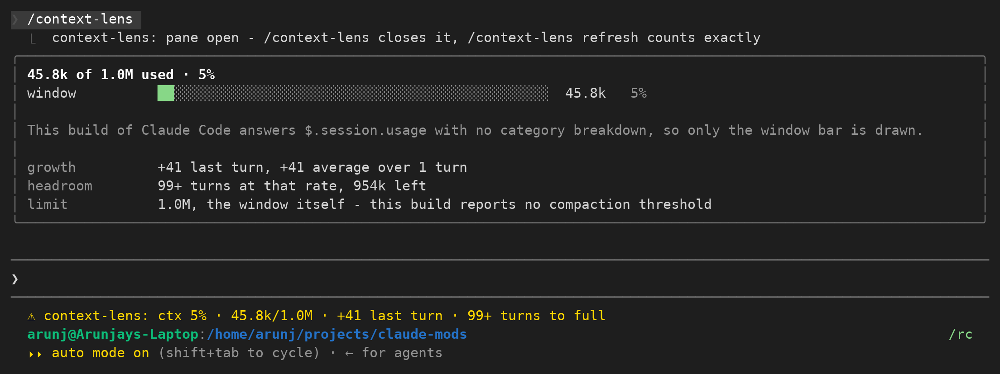

# context-lens

A live `/context`.

Claude Code's `/context` only shows the context window when you ask for it.
`context-lens` keeps the same figures on screen in a pinned line under the prompt that updates after every turn, plus a pane that breaks the window down by category.

## What it shows

The pinned status line sits under the prompt from the start of the session:

```
ctx 5% · 45.9k/1.0M · +44 last turn · 99+ turns to full
```

From left to right it shows how full the context window is, the tokens used out of the window size, what the last turn added, and how many more turns fit at the recent average growth.
Figures the engine has not reported yet are left out, so the line is shorter early in a session.
Before the first answer comes back it reads `ctx waiting for the first answer`.

`/context-lens` opens a pane with the same reading in full:

```
45.9k of 1.0M used · 5% · claude-opus-5
window          ██░░░░░░░░░░░░░░░░░░░░░░░░░░░░░░░░░░░░░░░░░░░░░░  45.9k   5%

messages        █░░░░░░░░░░░░░░░░░░░░░░░░░░░░░░░░░░░░░░░░░░░░░░░  22.4k   2%
system tools    █░░░░░░░░░░░░░░░░░░░░░░░░░░░░░░░░░░░░░░░░░░░░░░░  14.2k   1%
memory files    █░░░░░░░░░░░░░░░░░░░░░░░░░░░░░░░░░░░░░░░░░░░░░░░   4.9k   0%
system prompt   █░░░░░░░░░░░░░░░░░░░░░░░░░░░░░░░░░░░░░░░░░░░░░░░   3.1k   0%
autocompact bu… ██░░░░░░░░░░░░░░░░░░░░░░░░░░░░░░░░░░░░░░░░░░░░░░  45.0k   5%
free space      ████████████████████████████████████████████░░░░   910k  91%

growth          +4.2k last turn, +3.8k average over 5 turns
headroom        12 turns at that rate, 754k left
limit           800k, where auto-compaction runs
counted         locally, as an estimate - /context-lens refresh counts exactly
```

Each bar is sized to the pane's width, so it fits whether the pane is docked or inline.

Running `/context-lens` again closes the pane.
`/context-lens refresh` counts every category with the token-count API, the way `/context` does, and says so in the `counted` row.



## How it reads the window

Everything comes from one call, `$.session.usage`.

After each finished turn the mod asks for `breakdown: "summary"`, which estimates locally and sends no requests, so the line costs nothing.
`/context-lens refresh` asks for `breakdown: "full"`, which sends one token-count request per tool and memory file.
That is the only part of this mod that costs anything, and it only runs when you ask.

The growth figures come from a small in-memory list of the token count after each turn.
A compaction clears that list, because the window it measured is gone.

The compaction line prefers the engine's own `autoCompactThreshold` from the breakdown.
When auto-compaction is off it uses the compaction window (`rawMaxTokens`) instead.
With no breakdown at all it uses the context window size, and in each case it says which number it used.

## Install

```
claude plugin marketplace add Arunjay4213/claude-mods
claude plugin install context-lens@claude-mods
```

Mods are early access, so the module only loads when the function-hooks flag is set.
Add it to `~/.claude/settings.json`:

```json
{
  "env": { "CLAUDE_CODE_ENABLE_FUNCTION_HOOKS": "1" }
}
```

or set it on the command line for one run:

```
CLAUDE_CODE_ENABLE_FUNCTION_HOOKS=1 claude
```

To run it from a checkout instead:

```
CLAUDE_CODE_ENABLE_FUNCTION_HOOKS=1 claude --plugin-dir plugins/context-lens
```

## Limitations

- The per-category bars need `$.session.usage({ breakdown })`.
Claude Code 2.1.272 and later answer it with the categories and the auto-compaction threshold, and the pane draws them.
Claude Code 2.1.270 and earlier answer with only `tokens`, `window` and `percent`, so on those builds the pane draws the window bar alone, says so in place of the category rows, and measures headroom against the whole window.
- `tokens` and `percent` come from the last API response, so a fresh or just-compacted session has no reading until its next answer.
- The turns estimate is a straight line through the recent turns that grew.
  One large file read moves it a long way, so treat it as a rough guide.
- The engine decides where the pane goes.
  In the fullscreen layout from 110 columns it docks beside the transcript; otherwise it sits inline above the prompt, gets about a third of the screen, and a long category list scrolls.
- Each plugin gets one pinned status line, which the engine draws with its own notice mark.
