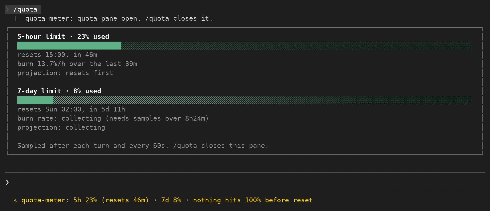

# quota-meter

Your Claude subscription has usage windows: a 5-hour one, a 7-day one, and on a Claude gateway a spend limit.
Claude Code reports how full each one is, but only in a notice that appears once you are already close.
`quota-meter` keeps that reading on screen for the whole session, with a countdown to the reset and an estimate of how long the current pace can last.

## What it shows

A line is pinned under the prompt from the start of the session:

```
5h 15% (resets 1h23m) · 7d 6% · nothing hits 100% before reset
```

The end of the line is the part to watch, and it says one of three things:

- `5h full in ~2h05m` means that at the recent pace this window fills before it resets.
- `nothing hits 100% before reset` means every window resets before the pace could fill it.
- `collecting burn rate` means no window has been watched long enough to have a usable rate yet.
  A window that is still collecting is left out of this part of the line, but it never hides a window that does have a rate.

When the account reports no windows at all the line reads `no plan limits reported yet`.
That is normal for an API-key session, and for the first few seconds of any session before Claude has answered once.

`/quota` opens and closes a pane with one block per window:

```
5-hour limit · 15% used
██████████░░░░░░░░░░░░░░░░░░░░░░░░░░░░░░░░░░░░░░░░░░░░░░░░░░░░░░░
resets 15:00, in 1h23m
burn 24.4%/h over the last 2m
projection: resets first

7-day limit · 6% used
████░░░░░░░░░░░░░░░░░░░░░░░░░░░░░░░░░░░░░░░░░░░░░░░░░░░░░░░░░░░░░
resets Sun 02:00, in 5d 12h
burn 0.0%/h over the last 2m
projection: steady, not rising
```

The bar is drawn to the pane's width, so it fits both when the pane is docked beside the transcript (110 columns and up, in the fullscreen layout) and when it sits inline above the prompt on a narrow terminal.
The reset is shown both as a clock time and as a countdown.

## Install

```
claude plugin marketplace add Arunjay4213/claude-mods
claude plugin install quota-meter@claude-mods
```

Mods are early access, so the hooks module only loads when function hooks are switched on.
Add this to `~/.claude/settings.json`:

```json
{
  "env": { "CLAUDE_CODE_ENABLE_FUNCTION_HOOKS": "1" }
}
```

or set `CLAUDE_CODE_ENABLE_FUNCTION_HOOKS=1` on the command line for one run.

To try it from a checkout without installing:

```
CLAUDE_CODE_ENABLE_FUNCTION_HOOKS=1 claude --plugin-dir plugins/quota-meter
```

## Screenshot



## How the projection is computed

`$.session.usage()` reports the windows the last API response carried, each as `{ kind, percentUsed, resetsAt }`.
The mod reads it after every finished turn and on a 60 second tick, and keeps each reading as `{ atMs, percentUsed }` in `$.store`.

The burn rate is the slope from the first reading to the last, `(last percent - first percent) / (last time - first time)`, in percent per hour.
It uses that instead of a least-squares fit because the readings inside one window form a step function that only rises, and a fit through the middle of it would understate where the window is now.

A rate is only quoted once the readings span 5% of the window, which is 15 minutes for the 5-hour window and about 8.4 hours for the 7-day one (spend limits use the same 7-day clock).
Until then both the line and the pane say `collecting`.
The wait is there because the API reports usage as a whole percent.
If a 7-day window ticks from 6% to 7% during a 16 minute span, that reads as 3.8% per hour and projects a full window in a day, while the same single tick spread over 8.4 hours reads as the small movement it really was.
Percent values are also rounded to whole numbers before any math, because the API sometimes reports `7.000000000000001`.

The projection is the remaining percent divided by the rate, `(100 - percentUsed) / burn`.
If the window resets before that point, the mod says `resets first`, and if the rate is zero or falling it says `steady, not rising`.

Old readings are dropped once they no longer describe the current window.
Anything older than the window length goes, and when the percent falls by more than half a point the window has reset, so every reading before that is discarded.
Readings persist in `$.store`, so restarting Claude Code inside the same window keeps the rate you had built up.

Nothing is estimated or filled in: if the API does not report a figure, the mod reports it as missing.

## Limitations

- API-key sessions report no limits.
  `rateLimits` is empty without a subscription, so both the line and the pane show `no plan limits reported yet`.
- The first reading needs a turn.
  At session start the last response is the previous session's, or there is none, so the line may say `no plan limits reported yet` until Claude answers once.
- The 7-day window takes 8.4 hours to show a rate, since that is when its whole-percent readings stop being noise.
  Until then a fresh session shows `collecting` for it and projects only from the 5-hour window.
  The pane always prints the span a rate was measured over, so you can judge how much to trust it.
- `spend_limit` has no fixed length, so its readings are kept for seven days, and it can read above 100% once the limit is passed.
  The bar stops at full but the percent keeps going.
- There is one pane at a time: `/quota` toggles, so running it again closes the pane, the same way `/diff` does.

## Layout

```
.claude-plugin/plugin.json   name, version, description
hooks/hooks.json             names the module
hooks/register.tsx           the hooks: sampling, the status line, the command, the pane
hooks/quota.ts               the numbers and the wording, with no engine calls in them
```
