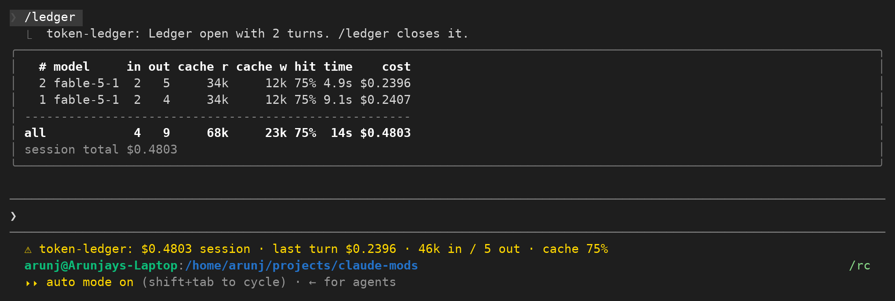

# token-ledger

A per-turn cost and token ledger for Claude Code, built as a mod (function hooks).

It shows, while you work, what the last turn cost and how much of its input came from the cache.

## What it shows

A status line is pinned under the prompt and updates when each turn ends:

```
$0.4799 session · last turn $0.2394 · 46k in / 5 out · cache 75%
```

On this line, `in` counts all the input the answer was read over (fresh input, cache reads and cache writes together), and `cache` is the share of it that came from the cache.
A figure the engine does not have is left out, so the line gets shorter instead of showing a zero or a blank.

`/ledger` opens a pane with one row per turn, newest first:

```
  # model     in out cache r cache w hit time    cost
  2 fable-5-1  2   5     34k     12k 75% 2.8s $0.2394
  1 fable-5-1  2   4     34k     11k 75% 3.0s $0.2405
-----------------------------------------------------
all            4   9     68k     23k 75% 5.8s $0.4799
session total $0.4799
```

Here the `in` column is the API's `input_tokens` alone, the part that was neither read from the cache nor written to it.
`in`, `cache r` and `cache w` added together give the `in` figure on the status line.

Run `/ledger` again to close it.
The pane docks beside the transcript from 110 terminal columns and sits inline above the prompt below that.

Columns are fitted to the pane width.
When the pane is too narrow for all of them, they are dropped in this order: duration, cache write, turn number, model, hit ratio, cache read, output tokens, input tokens.
Cost always stays.
At 44 terminal columns, for example, duration and cache write are dropped and the rest still lines up.

## Install

```
claude plugin marketplace add Arunjay4213/claude-mods
claude plugin install token-ledger@claude-mods
```

Mods are early access, so the module only loads when function hooks are switched on.
Add this to `~/.claude/settings.json`:

```json
{ "env": { "CLAUDE_CODE_ENABLE_FUNCTION_HOOKS": "1" } }
```

Or set it for one run: `CLAUDE_CODE_ENABLE_FUNCTION_HOOKS=1 claude`.

## Screenshot



## How the numbers are worked out

Token counts come straight from the `turn.complete` event: `e.usage.input_tokens`, `output_tokens`, `cache_read_input_tokens` and `cache_creation_input_tokens`, with `e.usage.model` for the model name and `e.durationMs` for the duration.
These are the API's own counts for the turn.

Cache hit ratio is `cache_read / (input + cache_read + cache_creation)`.
When that denominator is zero, the cell shows `-`.

The ledger does not price tokens itself.
It reads the session total from `$.session.usage()` as `cost.usd` (the same figure `/cost` and the status line report) once when the session starts and again after every turn, and a turn's cost is the change between two readings.

There is no pricing table in this plugin on purpose.
Rates differ by model, plan, cache tier and gateway, and they change over time, so a table inside a plugin would go stale and print wrong numbers with no warning.
The ledger only reports what the engine has already priced.

## Limitations

The first reading is taken at `session.start`, so a turn is only priced once the ledger has a baseline.
If the engine reports no cost at all (a host that keeps no cost ledger), the cost column shows `-` and the status line drops the dollar figures.

Cost is attributed to whichever turn finished between two readings.
A subagent's turn finishes inside the main turn, so its cost lands on the subagent's row and the main turn's row shows only what was left.
Subagent rows are marked with `*` after the turn number and drawn dim.

The ledger keeps the last 200 turns.
It is mirrored into `$.store` under the session id, so `/ledger` keeps the history after `/resume`, and a new session starts with an empty ledger.
The pane draws the newest 40 rows and counts the rest in the totals.

The dollar figures are rounded for display (2 decimals from $1, 4 below it).
The totals row adds the stored per-turn values, so it can differ from the session total by a fraction of a cent when rounding, or by more if some turns had no baseline.
The session total line is always the engine's own figure.
